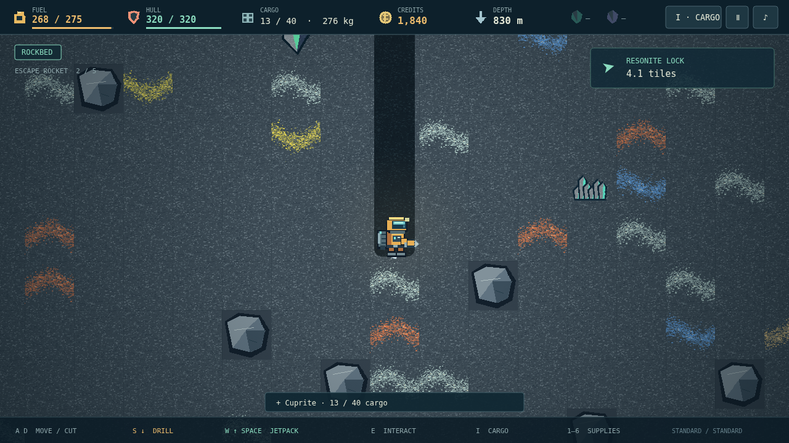

# Deepcore

You are the last light on a dead mining world. Your dropship is wrecked, the outpost is running on scraps, and the only way home is a rocket you have to build yourself. Everything it needs is somewhere beneath your boots.

Drill a shaft into the banded earth, follow a promising vein, and fill your cargo bay. Falling is free. Getting back isn’t. Every piece of ore makes you heavier; every second of jetpack thrust eats into the fuel you need to see the surface again. A rich haul means nothing if you can’t lift it.

Sell what you bring home. Buy enough fuel for another round trip, patch your hull, and decide what matters next: a stronger drill, a bigger bay, better lift, or another piece of your escape rocket. Bank an expedition at the Save Pad, or choose Hardcore and live with every decision.

Below the gray rock, lava pools glow through near-black stone. Watch for the faint breath of gas pockets. Follow your scanner to rare crystals, then descend through the red shell to the Core itself. Its Sample gives you ninety seconds to bring the last piece home. The only thing more dangerous than going deeper is staying too long.
